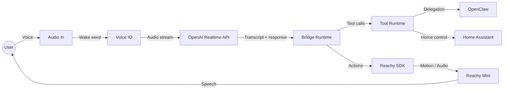

# dobby-the-claw

An orchestration bridge that brings **Dobby** to life — a sharp-witted, sarcastic AI assistant embodied in a [Reachy Mini](https://www.pollen-robotics.com/reachy-mini/) robot. Dobby speaks Brazilian Portuguese by default, reacts to voice commands, controls smart home devices, and can delegate complex tasks to a secondary AI agent (OpenClaw).

```
User → voice → OpenAI Realtime API → Bridge → Reachy Mini (motion, gestures, speech)
                                             → OpenClaw (complex task delegation)
                                             → Home Assistant (smart home control)
```

## Features

- **Realtime voice conversation** via OpenAI Realtime API — low latency, streaming audio, interruption support
- **Physical embodiment** — Reachy Mini gestures, head tracking, antenna expressions, camera vision
- **Wake word detection** — robot sleeps when idle and wakes on "Dobby" (offline: speech bursts are transcribed with faster-whisper)
- **Speaker identification** — recognizes faces via InsightFace; Dobby addresses each person by name and can enroll new profiles mid-conversation
- **Per-speaker persistent memory** — extracts lasting facts from each session (via mem0 + OpenAI) and injects them at next session start
- **Proactive reminders** — schedules one-time or recurring reminders natively, with persistence across bridge restarts
- **Smart home control** — discovers and controls Home Assistant devices via voice
- **Task delegation** — offloads complex or long-running tasks to OpenClaw
- **Finger-to-antenna control** — index fingers mapped to antenna angles via MediaPipe

## Requirements

**Hardware**
- [Reachy Mini](https://www.pollen-robotics.com/reachy-mini/) with its daemon running (see [Raspberry Pi setup](docs/raspberry-integration.md))

**Software**
- Python 3.11
- OpenAI API key with Realtime API access

## Setup

### 1. Clone and create virtualenv

```bash
git clone https://github.com/your-org/dobby-the-claw.git
cd dobby-the-claw
python -m venv .venv
source .venv/bin/activate        # Windows: .venv\Scripts\activate
pip install -r requirements.txt
```

### 2. Configure environment

```bash
cp .env.example .env
```

Edit `.env` and fill in at minimum:

| Variable | Description |
|---|---|
| `OPENAI_API_KEY` | Your OpenAI API key |
| `REACHY_BRIDGE_URL` | `sdk` to connect via Reachy SDK (default) |

For optional integrations:

| Variable | Description |
|---|---|
| `OPENCLAW_BEARER_TOKEN` | Token from OpenClaw setup |
| `HOME_ASSISTANT_URL` | Home Assistant base URL (ex.: `http://127.0.0.1:8123`) |
| `HOME_ASSISTANT_TOKEN` | Long-lived token from HA profile |

Full reference in [`.env.example`](.env.example).

### 3. Wake word

Nothing to train. While Dobby sleeps, every burst of speech is transcribed locally with
[faster-whisper](https://github.com/SYSTRAN/faster-whisper) and the robot wakes when the text says
"Dobby" (or another name in `OFFLINE_WAKEWORD_ALIASES`). The model (`base`, ~150 MB) downloads once
into the Hugging Face cache. The web UI's *Configurações → Acordar* page has a test that shows what
it heard.

### 4. Run

```bash
PYTHONPATH=src python -m bridge.main
```

The web UI (status, chat, camera with detections, filtered logs and controls; installable as a phone app) is served at <http://localhost:18900>. For access from the phone, see [`docs/web-ui.md`](docs/web-ui.md).

## Raspberry Pi Deployment

The Reachy Mini daemon runs natively on a Raspberry Pi 4 (8 GB RAM). The bridge can run locally and connect to the Pi via SSH tunnels.

```bash
# Open all tunnels (Reachy SDK, OpenClaw, Home Assistant)
./scripts/tunnel.sh

# Stop tunnels
./scripts/tunnel.sh stop
```

Full setup guide: [docs/raspberry-integration.md](docs/raspberry-integration.md)

## Architecture

See [docs/architecture.md](docs/architecture.md) for a full breakdown of components, state machine, data flow, and ports & adapters design.



## Configuration Reference

Key environment variables (full list in `.env.example`):

| Variable | Default | Description |
|---|---|---|
| `REACHY_BRIDGE_URL` | `sdk` | `sdk` for local SDK connection |
| `REALTIME_MODEL` | `gpt-realtime` | OpenAI Realtime model |
| `STT_LANGUAGE` | `pt` | Speech recognition language |
| `IDLE_SLEEP_TIMEOUT_S` | `300` | Seconds of silence before sleep |
| `OFFLINE_WAKEWORD_ENABLED` | `1` | Sleep when idle and wake on the robot's name |
| `OFFLINE_WAKEWORD_MODEL` | `base` | Whisper model that hears the wake word (`base` or `small`) |
| `SPEAKER_ID_ENABLED` | `1` | Enable face-based speaker identification (requires insightface) |
| `SPEAKER_ID_PROFILES_DIR` | `~/.dobby/face_profiles` | Directory for enrolled face and voice profiles |
| `VOICE_ID_ENABLED` | `1` | Also identify speakers by voice (requires sherpa-onnx; voice profiles are learned from face matches) |
| `VOICE_ID_MODEL_PATH` | _(empty)_ | Speaker-embedding `.onnx` model; empty downloads CAM++ to `models/speaker/` |
| `PRESENCE_ENABLED` | `1` | Detect people (MediaPipe) to follow them at a distance, choose whom to look at, and tell the model who arrived or left |
| `PERSON_DETECTOR_MODEL` | _(empty)_ | `yolox_tiny` (default, downloaded to `models/vision/`), `yolox_s`, `efficientdet_lite0`/`efficientdet_lite2`, or an `.onnx`/`.tflite` path |
| `PRESENCE_GREET_COOLDOWN_S` | `10800` | Seconds before the same person is greeted again |
| `SPEAKER_MEMORY_ENABLED` | `0` | Enable per-speaker persistent memory via mem0 |
| `SPEAKER_MEMORY_MODEL` | `gpt-4o-mini` | Model used to extract facts from sessions |
| `SPEAKER_MEMORY_DIR` | `~/.dobby/memories` | Directory for mem0 storage (Qdrant + SQLite) |
| `NOTIFICATION_SERVER_PORT` | `18800` | Port for the local notification server used by async external notifications |
| `SCHEDULER_JOBS_FILE` | `~/.dobby/scheduler_jobs.json` | Persistent storage for native scheduled reminders |
| `HOME_ASSISTANT_ENABLED` | `0` | Enable Home Assistant integration |
| `OPENCLAW_ENABLED` | `1` | Enable OpenClaw task delegation |

## Development

**Lint / format:**
```bash
ruff check .
ruff format .
```

No automated test suite — validation is done by running the bridge and using the web UI.

**VS Code:** the launch configuration are in `.vscode/launch.json`.
